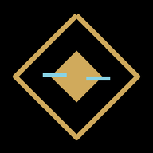

  

<h1 align="center">Orbiter Panel</h1>

  A Warframe second-screen companion for Android, built for the bottom screen of the AYN Thor. 
  Live world timers, fissures, missions, vendors, warframe.market prices and drop chances, at a glance while you play.

  <a href="../../releases/latest"><b>Download the latest APK</b></a>

> [!IMPORTANT]
> **Unofficial fan project, built with AI.** This app was designed and written with the help of an AI assistant (Anthropic's Claude), with direction and testing by the repository owner. It is not made, endorsed or supported by Digital Extremes. Read the [disclaimers](#disclaimers) before using it.

---

## Features

**World**
- Open-world cycles for Cetus, Orb Vallis, Cambion Drift, the Zariman, Earth and Duviri, with countdowns and the next state's local time
- Countdowns to the daily reset, sortie, Archon Hunt, Baro Ki'Teer, Teshin's rotation and Darvo's deal; tap a vendor for its details (Baro's location and stock, Teshin's reward, Darvo's price)

**Fissures**
- Every active Void Fissure, split into Normal, Steel Path and Void Storms
- Filter by relic tier, or show only fast missions (Capture, Extermination, Sabotage, Rescue)

**Missions**
- Running events as a strip of title cards at the top; tap one for its own animation, then progress with milestone markers, every reward tier with pictures, pickups and bounties. Animated themes for recurring events (Plague Star, Ghoul Purge, Star Days, Dog Days, Tennobaum, Lunar New Year, Fomorian and Razorback, Sentient anomalies, Kuva Floods, anniversaries and more) are built in for when they return
- Today's sortie with modifiers, this week's Archon Hunt and the shard it awards
- Invasions folded into one line that names any rewards worth chasing; tap to expand
- Alerts, and Nightwave challenges you can tick off with the standing you have left

**Search**
- Every item in the game, tradable or not, with pictures as you type
- Live warframe.market prices: lowest sell, highest buy, and the online sellers and buyers, with a one-tap copy of the trade whisper
- Drop sources with drop chances, relic refinement chances, relic contents, and where resources are found

**Home screen widgets**
- Open-world cycles, one big cycle, resets or fissures, each widget with its own settings
- Adjustable transparency (fully clear to solid), hairline frame, text size and accent color
- Countdowns tick live; the widgets refresh in the background about every 30 minutes

**Made for the Thor's bottom screen**
- Text and layout scale to fill the small square screen, with an adjustable text size
- Full screen, no browser bars, and stays put when moved between screens
- Checks this repository for new builds and updates itself from Settings

## Install

1. On your Android device, open the [latest release](../../releases/latest) and download **OrbiterPanel.apk**.
2. Open it. If Android asks, allow your browser or file manager to **install unknown apps**.
3. On the AYN Thor, long-press the **Orbiter Panel** icon and choose **Bottom Screen**, then start Warframe on the top screen.

**Updating:** open Settings in the app and tap **Check for updates**. The first time, Android asks you to allow Orbiter Panel to install apps. Updates keep your settings.

Requires Android 8.0 or newer. Works on any Android phone or tablet, not only the Thor.

## How it works

| Part | What it is |
| --- | --- |
| `web/` | The app itself: one HTML page, an item index, the backup world-state parser and icons. It is bundled into the APK. |
| `app/` | A small Android wrapper: a full-screen WebView that serves `web/` from inside the APK, fetches live data natively and handles updates. |
| `.github/workflows/build-apk.yml` | Builds a signed APK on every push to `main` and publishes it to Releases as `build-N`. |

**Data sources**
- World state and drop tables: [warframestat.us](https://warframestat.us), a community API run by WFCD
- Backup world state: Digital Extremes' official feed (`api.warframe.com/cdn/worldState.php`), read directly when warframestat.us is down and parsed in the app with WFCD's [warframe-worldstate-parser](https://github.com/WFCD/warframe-worldstate-parser) (MIT License, bundled as `web/worldstate-parser.js`)
- Prices and orders: [warframe.market](https://warframe.market)
- Item names, pictures and resource locations: the [@wfcd/items](https://github.com/WFCD/warframe-items) data package; pictures load from cdn.warframestat.us

The app only reads public data. It never asks for your Warframe login, never reads the game's memory or files, and does not interact with the game in any way.

## Building it yourself

Push to `main` (or run the **Build APK** workflow by hand) and GitHub builds the APK in a few minutes. To build locally, install JDK 17, the Android SDK and Gradle 8.9, then run `gradle :app:assembleRelease`.

Every build is signed with the key in `app/orbiter.keystore` so new builds install over old ones. That key only identifies this hobby app and is intentionally public. If you fork the project, generate your own key.

## Disclaimers

- **Built with AI.** Most of the code, design and text in this repository was produced with an AI assistant (Anthropic's Claude) under the owner's direction. It has been tested, but it may still contain mistakes. Check anything important in game.
- **Not affiliated with Digital Extremes.** Warframe and all related names, images and game data are trademarks and property of Digital Extremes Ltd. Game images are shown for non-commercial fan use under the [Warframe Content Policy](https://www.warframe.com/contentpolicy). No Warframe or Digital Extremes logos are used.
- **Third-party data.** Timers, drop chances and prices come from community services (warframestat.us, warframe.market) that this project doesn't control. They can be late, wrong or unavailable. Some cycle timers are estimated from fixed cycle lengths when the data lags; those show "≈".
- **No warranty.** The app is provided as is, free and non-commercial, with no guarantee of accuracy or availability. You install and use it at your own risk. Trading decisions are your own.
- **Sideloaded app.** It is distributed as an APK outside the Play Store. Only install builds from this repository's Releases page.
